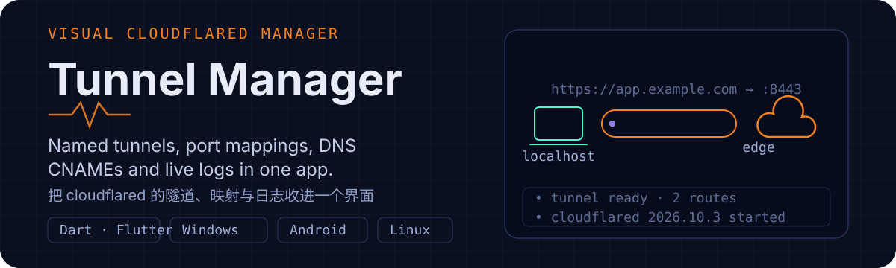

  

# Cloudflare Tunnel Manager

Cloudflare Tunnel 内网穿透管理客户端：Windows 桌面（Flutter）、Android，以及无头 Linux 服务器的 Web 面板。把 `cloudflared` 的登录、命名隧道、端口映射、DNS CNAME 与实时日志整合到可视化界面，**无需公网 IP、无需开放入站端口**。

**[下载 Releases](https://github.com/KelierAndes/Cloudflare-Tunnel-App/releases)** · MIT

## 下载

| 平台 | 文件 |
| --- | --- |
| Windows 10/11 x64 | `CloudflareTunnelManager-1.0.0-win64.zip`（解压即用，内置 cloudflared） |
| Android | `*-arm64-v8a.apk`（主流手机）/ `*-x86_64.apk`（模拟器）/ `*-universal.apk` |
| Linux 服务器 | `cloudflare-tunnel-webui-1.0.0.tar.gz`（解压后 `sudo bash install.sh`） |

## 功能亮点

- **命名隧道 + 云端同步**：应用内创建 / 删除隧道，凭证存本机；换机或清数据后点「同步云端」直接取回原隧道凭证，**不需要重建隧道**。
- **域名 + 端口映射**：把托管在 Cloudflare 的域名（可带路径）转发到 `localhost:<端口>`，一键创建 DNS CNAME，可选覆盖已有记录。
- **启停与后台**：单条 / 全部启停、开机自动连接；关窗最小化到托盘继续运行，隧道数量显示在托盘图标上。
- **临时隧道**：无需登录，输入本机端口即生成 `*.trycloudflare.com` 随机地址，适合快速验证（停止即失效）。
- **实时日志**：按来源聚合 cloudflared 的 stdout / stderr，支持自动滚动、复制、清空。
- **运行时管理**：内置官方 cloudflared（离线可用），可一键升级最新版或指定本地路径。
- **主题**：深色 / 浅色 / 跟随系统，原生标题栏同步换色。

## 快速开始

1. 解压运行 `cf_tunnel_manager.exe`，点「立即登录」，在浏览器中授权已托管在 Cloudflare 的域名。
2. 「隧道」页 →「新建隧道」→ 输入名称。
3. 添加端口映射：公网域名 + 本机端口，勾选「同时创建 DNS CNAME 记录」。
4. 点「启动」，公网访问 `https://你的域名` 即可到达本机端口。

> 域名必须已托管在 Cloudflare；已有 A / CNAME 记录时需勾选「覆盖已存在的 DNS 记录」。

## 注意事项

- 首次运行可能弹 Windows 防火墙授权：应用只需出站连接，不开放入站端口，建议允许「专用网络」。
- 删除隧道**不会**自动删除 DNS 记录；退出账户只删本机 `cert.pem`，不动云端隧道。
- 云端已删除的隧道只标记不清理，避免误删；同一域名 + 路径不能重复映射。
- 更新 cloudflared 运行时的请先停止所有隧道（Windows 会锁定运行中的 exe）。
- 所有证书、凭证与配置保存在 `%APPDATA%\com.qodertunnel\cf_tunnel_manager\`，「设置 → 本地数据」可直达。

## 平台支持

| 平台 | 状态 |
| --- | --- |
| Windows 10/11 x64 | 完整可用，端到端验证 |
| Linux 服务器 | Web 面板（Python 标准库，`bash webui/install.sh` 一键部署，Debian 12 验证） |
| Android arm64-v8a / x86_64 | 可运行，隧道直连边缘；APK 内置自编译 `libcloudflared.so`，Android 14 真机验证 |
| Linux 桌面 | 工程就绪，需在原生 Linux / WSL2 构建 |

从源码构建（Flutter 3.38+ / VS Build Tools）、Android 运行时编译与镜像配置见 [DEVELOPMENT.md](DEVELOPMENT.md)。

## 许可

[MIT](LICENSE)。随包分发的 `cloudflared` 及 Flutter 依赖遵循各自许可证，见 [THIRD_PARTY_NOTICES.md](THIRD_PARTY_NOTICES.md)。
